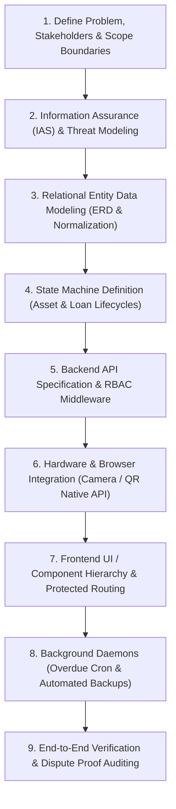

# EquipTrack: School & Office Equipment Borrowing System

**EquipTrack** is a centralized web-based management platform engineered to eliminate lost equipment and unrecorded item damage by replacing error-prone paper logbooks with a QR-based digital system equipped with photo verification and 3-tier Role-Based Access Controls (RBAC).

---

## Part 1: "If I Ever Were to Create a System, What Should I Follow First?"

When building an institutional software system from scratch (such as EquipTrack, ERPs, or reservation platforms), following the correct sequence prevents rewrites, security holes, and broken data models. Here is the industry standard architectural sequence to follow:



### 1. Requirements & Boundary Definition (Day 1)
- **Identify User Personas & Objectives**: Determine who interacts with the system and their primary jobs to be done.
  - *Borrowers*: Need rapid catalog search, live availability, and return deadline awareness.
  - *Custodians*: Need fast zero-typing checkout/checkin, camera-based QR tag recognition, and visual condition proof.
  - *Admins*: Need master inventory CRUD, user role management, system health, and tamper-evident audit logs.
- **Define Boundaries (In-Scope vs Out-of-Scope)**: Set hard limits early. For instance, EquipTrack deliberately stays web-based (no dedicated hardware scanners or payment kiosks required) to ensure zero friction on standard mobile browsers.

### 2. Information Assurance & Security (IAS) Architecture
- Before writing endpoints, plan the security controls:
  - **Authentication**: JWT tokens with secure expiration.
  - **Authorization (RBAC)**: Strict server-side route guards ensuring Borrowers cannot approve loans or edit equipment.
  - **Input Sanitization & Parameterized Queries**: Protect against SQL injection and XSS.
  - **Audit Logging**: Create an append-only audit trail logging *who*, *what*, *when*, *entity ID*, and *IP address*.

### 3. Entity Modeling & Relational Schema
- Model entities with foreign keys and cascade rules:
  - `users`: Credentials, RBAC roles, contact and department info.
  - `equipment`: Unique asset tag, model, serial number, current status (`AVAILABLE`, `BORROWED`, `UNDER_REPAIR`, `ARCHIVED`), condition baseline, location, QR data URL.
  - `transactions`: Loan lifecycle linking `equipment_id`, `borrower_id`, and `custodian_id`, with checkout/return timestamps and notes.
  - `transaction_photos`: Condition evidence with `photo_type` (`CHECK_OUT` vs `CHECK_IN`), image URLs, and captions.
  - `audit_logs`: Immutable security action history.

### 4. Finite State Machine (Asset & Loan Lifecycles)
Define explicit state transitions:
- Equipment: `AVAILABLE` $\rightarrow$ `BORROWED` $\rightarrow$ `UNDER_REPAIR` (if damage detected upon return) or `AVAILABLE` (if clean).
- Transaction: `PENDING` $\rightarrow$ `APPROVED` $\rightarrow$ `CHECKED_OUT` $\rightarrow$ `RETURNED` (or `OVERDUE`).

### 5. Backend REST API & Multipart Engine
- Build atomic REST endpoints for auth, inventory, borrowing, check-in/out, and system operations.
- Integrate multipart storage (`multer`) to capture multiple high-resolution condition inspection photos.

### 6. Hardware & Browser Native Integration
- Connect browser camera streams directly via HTML5 native APIs (`html5-qrcode` & `navigator.mediaDevices.getUserMedia`) for seamless scanning on phones and laptops without external scanners.

### 7. Frontend Role-Based Routing & UI
- Build role-specific interfaces:
  - `/catalog`: Available to all, online reservations, deadline dashboard.
  - `/custodian`: QR camera scanner, fast check-out, return inspection with pre/post photo comparison.
  - `/admin`: Master inventory CRUD, batch printable QR sticker sheets, user role governance, live audit trail, database backup center.

### 8. Automation & Daemons
- Background cron worker queries loans past `request_end_date` and dispatches automated overdue notices.
- Database backup snapshot generator.

---

## Part 2: Quick Start Guide

### Prerequisites
- Node.js (v18+)
- npm (v9+)

### Installation
From the root folder (`RMS`):

```bash
# 1. Install root, backend, and frontend dependencies
npm install
cd server && npm install
cd ../client && npm install
cd ..

# 2. Seed database with realistic institutional equipment & test accounts
npm run seed

# 3. Start both Backend API (:5000) and React Frontend (:3000) concurrently
npm run dev
```

Open your browser to:
**`http://localhost:3000`**

---

## Part 3: Preloaded Demo Accounts

For instant evaluation, the login page features **1-Click Demo Sign-In** buttons for each role, or you can log in manually:

| Role | Email | Password | Allowed Capabilities |
| :--- | :--- | :--- | :--- |
| **Borrower** (Student) | `borrower@school.edu` | `password123` | Equipment search, live green/orange badges, submit reservations, view deadlines |
| **Custodian** (Lab Tech) | `custodian@school.edu` | `password123` | Camera QR scanning, approve requests, photo inspection, return damage logs |
| **System Admin** (IT Lead) | `admin@school.edu` | `password123` | Master inventory CRUD, batch printable QR tags, user management, audit trail, DB backups |

*Tip: You can also use the role switcher in the top navigation bar at any time to test role permissions on the fly.*

---

## Part 4: Key Feature Verification Checklist

1. **Asset Inventory & Real-Time Availability**:
   - Available (Green badge)
   - Borrowed (Orange badge)
   - Under Repair (Red badge)
2. **Fast QR Camera Scanning**:
   - Custodian desk camera viewfinder with live HTML5 scanner and fallback manual tag input or 1-click test tags (`EQP-LAP-001`, `EQP-LAP-002`, `EQP-CAM-101`, etc.).
3. **Photo Damage Log Engine & Dispute Prevention**:
   - Check-Out Inspection: Snaps 1–2 baseline photos before releasing equipment.
   - Check-In Inspection: Post-return inspection. If damage is flagged, severity is selected, damage photos are attached, and status automatically moves to `Under Repair`.
   - Side-by-side comparison proof displays pre-handoff baseline photos next to return photos.
4. **Printable QR Asset Tags**:
   - In Admin Hub $\rightarrow$ click **"Print QR Sticker Tags"** to preview and print Avery label sticker sheets ready for physical equipment tags.
5. **Security & Audit Logs**:
   - Every login, loan approval, check-out, damage report, and backup is recorded in the Admin Security Audit Log with timestamp, user ID, role, and IP address.
6. **Automated Overdue Alerts**:
   - Automated daemon flags past-due items and issues overdue notices. Manual scan can also be triggered from the Admin Backups & Health tab.
